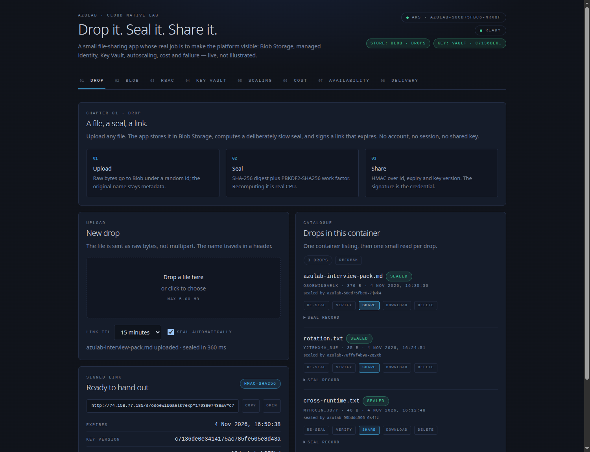
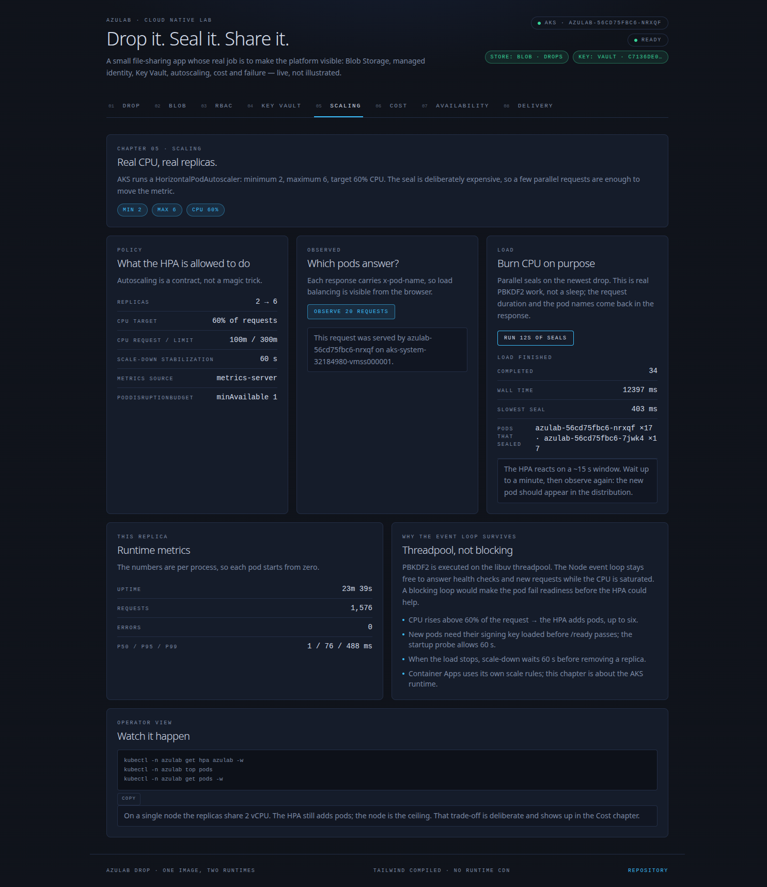

# 🚀 Azulab Drop — upload, seal, share

> A working file-sharing application whose real job is to make the platform
> visible: Blob Storage, managed identity, Key Vault, autoscaling, cost and
> failure — live, not illustrated.

Azulab is a small product with a deliberately serious backend. You upload a file,
the app stores it in a private Blob container, computes a slow cryptographic seal,
and signs a share link that expires. There is no account, no session and no shared
key. Every chapter of the UI then explains one Azure mechanism behind that flow.

---

## 🌟 What it does

1. **Upload** — raw bytes go to Blob Storage under a random id. The original
   filename stays metadata; the blob name is always `file`, so user input never
   reaches a path.
2. **Seal** — SHA-256 digest plus a PBKDF2-SHA256 work factor (600,000
   iterations). The seal is deliberately expensive to recompute; it runs on the
   libuv threadpool, so the Node event loop keeps answering.
3. **Share** — HMAC-SHA256 over `id`, expiry and key version. The key lives in
   Key Vault; the URL carries the version, so rotation does not break old links.
   Disabling a version revokes its links within a bounded 60 seconds.

Uploads are capped at 5 MB; links last 5, 15 or 60 minutes. The deployed app uses
the `drops` container in Blob Storage. `DROP_STORE=memory` is an explicit local-dev
mode and the UI labels it as such.

---

## 🧭 The eight chapters (the presentation agenda)

The UI is the presentation. Each tab makes one claim and proves it with live data
from the process answering the request.

| # | Chapter | The claim | What proves it | Azure mechanism |
| --- | --- | --- | --- | --- |
| 01 | **Drop** | Upload, seal, share — the product works. | A real file, a seal time, a signed URL, a download. | Blob Storage + HMAC key in Key Vault |
| 02 | **Blob** | Storage without a key. | Live object/version counts, bulk writes, soft-delete round trip. | Private container, shared key auth disabled, managed identity |
| 03 | **RBAC** | Identity, not keys. | Token claims + three probes: read secret 200, list blobs 200, list account keys 403. | Workload Identity, narrow roles on narrow scopes |
| 04 | **Key Vault** | The key never leaves the vault. | Version and fingerprint only; rotate and revoke commands. | Versioned secret, 5-minute current TTL, 60-second version re-check |
| 05 | **Scaling** | Real CPU, real replicas. | Per-pod seal distribution, HPA 2 → 6, CPU target 60%. | HPA on AKS, requests 100m / limits 300m |
| 06 | **Cost** | Small by design. | The bill, the levers, the lifecycle bound. | One node, one LB, ACA scale-to-zero, Cool 30 d / delete 90 d |
| 07 | **Availability** | Failure is a feature. | Crash and drain buttons; readiness drops a pod from endpoints. | Readiness vs liveness, PDB, maxUnavailable 0 |
| 08 | **Delivery** | One image. Two runtimes. | Commit SHA, image tag, pod; AKS and ACA side by side. | GitHub Actions, OIDC, GHCR, immutable SHA tags |

The screenshots below are from the deployed AKS instance:





---

## 🗺️ The big picture

```text
GitHub main
   │  pull request → lint, tests, docker build, terraform validate
   ▼
CI on main ──► ghcr.io/fantazyoosh/azulab-fnt:<commit-sha>
   │
   ├──────────────► AKS  (HPA 2–6, public LoadBalancer, no ingress auth)
   │                   │
   └──────────────► ACA  (Easy Auth / Entra ID, scale 0–2)
                       │
                       ▼
              managed identity / Workload Identity
                       │
          ┌────────────┴────────────┐
          ▼                         ▼
     Key Vault                  Blob Storage
  signing key, audit          drops/, no shared key
          │                         │
          └────────────┬────────────┘
                       ▼
                 Log Analytics
```

The same image runs on both runtimes. AKS demonstrates Kubernetes primitives
(probes, PDB, HPA, rolling updates); Container Apps demonstrates managed ingress
with Entra ID. Signed links work on both because `/s/*` stays anonymous while
everything else on ACA requires a session.

---

## 🛠️ The stack, and why it is not the easy way

| Technology | Role | Why this instead of the easy path? |
| --- | --- | --- |
| **Terraform** | Infrastructure as Code | Reproducible infrastructure, reviewed like code. |
| **OIDC** | GitHub → Azure federation | No stored cloud passwords in GitHub. |
| **Managed Identity** | Runtime authentication | The app *is* the identity; there is no secret to leak. |
| **Workload Identity** | Pod-level Azure auth | Short-lived projected token; no Kubernetes Secret. |
| **Azure Kubernetes Service** | Orchestrated compute | Probes, PDB, HPA and rolling updates on a real cluster. |
| **Azure Container Apps** | Managed runtime | Easy Auth with Entra ID and scale-to-zero. |
| **Key Vault** | Signing key | Versioned, audited, never rendered in the UI. |
| **Blob Storage** | Drop content | Private container, shared key disabled, lifecycle policy. |
| **Log Analytics** | Audit and diagnostics | Key Vault and Blob access is answerable, not guessed. |

---

## 🚀 Quick start

### Local run (developer experience)

```bash
cd app
npm install
DROP_STORE=memory npm start
```

Open `http://localhost:8080`. The memory store is explicit and ephemeral: drops
disappear when the process restarts, and the signing key is generated per process.
The UI shows a warning banner in this mode.

Without `DROP_STORE=memory` the app has no storage account configured and the Drop
chapter returns `503`; that is deliberate, not a missing default.

The UI uses Tailwind CSS compiled to a single `public/styles.css` (no runtime CDN).
After changing classes, rebuild it:

```bash
npm run build:css
```

### Cloud deploy (the DevOps experience)

1. Create a branch: `git checkout -b feat/my-feature`
2. Push and open a **Pull Request** — lint, tests, image build and Terraform
   validation run, but no image is published.
3. **Merge** — CI publishes `ghcr.io/…:<commit-sha>`, CD deploys the same tag to
   Container Apps and AKS, then smoke-tests both.

The image tag is the commit SHA, never `latest`.

---

## 📂 Documentation hub

**Start here:**

- **[Presentation runbook (`docs/presentation.md`)](docs/presentation.md)** — the
  15-minute pre-flight, the demo order and the fallbacks (Polish).
- **[Demo script (`docs/demo-script.md`)](docs/demo-script.md)** — commands and
  "what to say" for each of the eight chapters.
- **[Verification evidence (`docs/evidence/verification-2026-11-04.txt`)](docs/evidence/verification-2026-11-04.txt)**
  — the measured build: cross-runtime link, HPA 2 → 6 → 2, bounded revocation.

**Go deeper:**

1. **[Runbook (`docs/runbook.md`)](docs/runbook.md)** — code change to smoke test.
2. **[Security blueprint (`docs/security.md`)](docs/security.md)** — zero-trust,
   RBAC, Key Vault and storage controls.
3. **[Architect's Q&A (`docs/questions.md`)](docs/questions.md)** — how to justify
   the decisions out loud.
4. **[AKS runtime (`docs/aks.md`)](docs/aks.md)** — cluster design, Workload
   Identity, probes, HPA and cost.
5. **[RBAC matrix (`docs/rbac-matrix.md`)](docs/rbac-matrix.md)** — who can do
   what, on which scope.
6. **[Secret lifecycle (`docs/secret-lifecycle.md`)](docs/secret-lifecycle.md)** —
   where the signing key lives and how rotation/revocation work.
7. **[Architecture decisions (`docs/decisions.md`)](docs/decisions.md)** — the
   trade-offs, including the ones deliberately declined.
8. **[Key Vault + Blob deep dive (`docs/deep-dive-keyvault-blob.md`)](docs/deep-dive-keyvault-blob.md)**
   — layer by layer, with labs and audit proofs.
9. **[Entra login (`docs/entra-login.md`)](docs/entra-login.md)** — Easy Auth on
   Container Apps and the one long-lived secret.
10. **[Study plan (`docs/study.md`)](docs/study.md)** — five sessions, each with a
    proof command.
11. **[References (`docs/references.md`)](docs/references.md)** — Microsoft Learn
    reading list for RBAC, Key Vault, Blob and WAF.

---

## 🎓 What I learned building this

- **Control plane is not data plane**: an Owner can create a storage account and
  still get `403` when listing a blob.
- **Rotation and revocation are different operations**: a version in the URL keeps
  old links alive through rotation; disabling that version is what revokes them.
- **Scaling is a contract**: requests, limits, target utilization and a metrics
  window decide whether the HPA helps or flaps.
- **Cost is an architecture decision**: one node and one load balancer dominate
  the bill; lifecycle rules bound the only growing resource.
- **Readiness is not liveness**: a dependency failure should drain traffic, not
  restart every pod.
